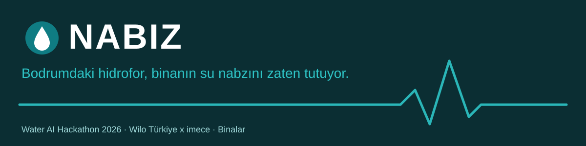
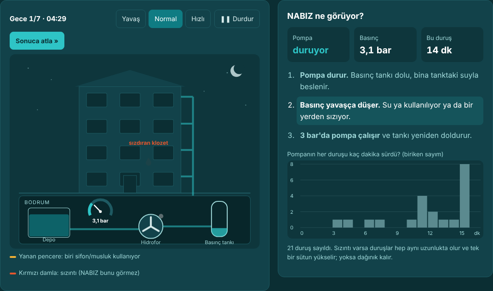
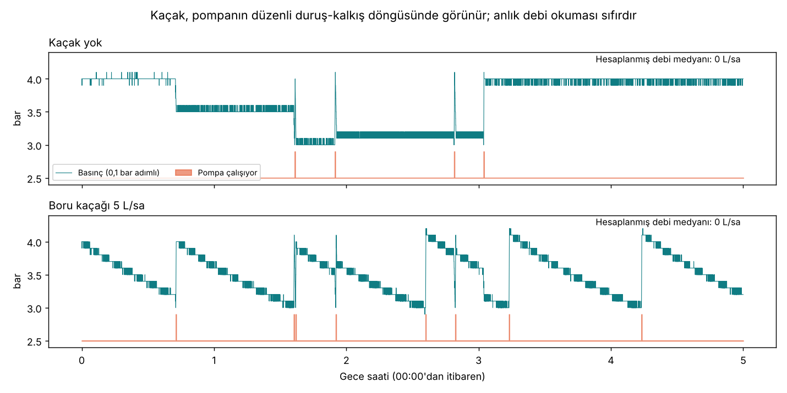
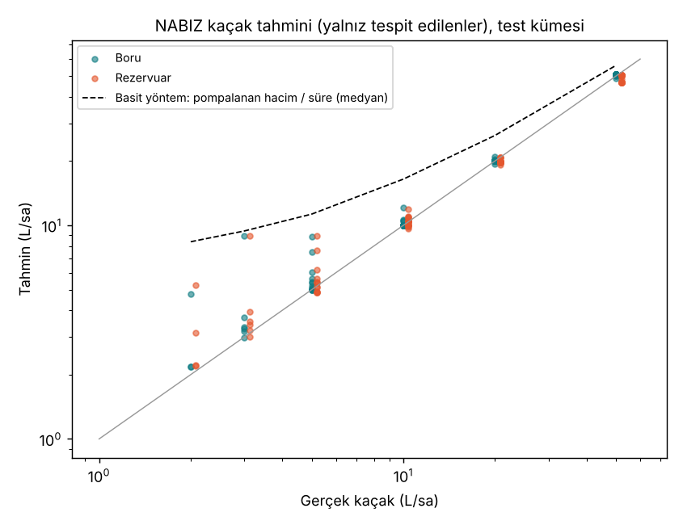
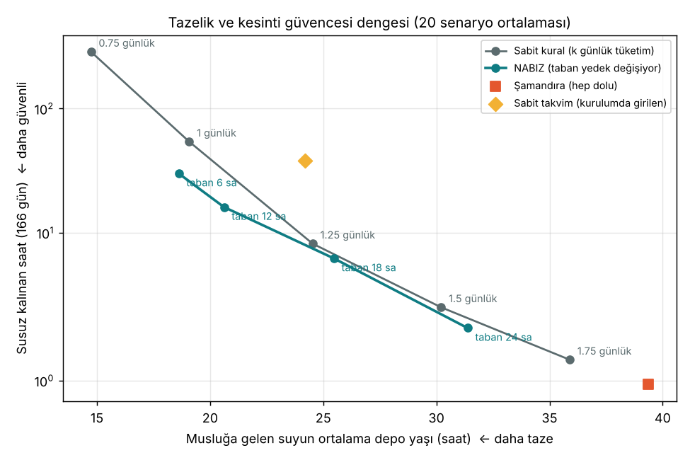
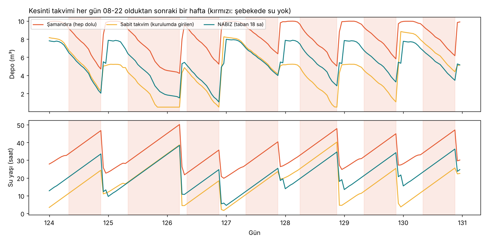

<p align="center">
  <a href="https://ugurfurkanyesil-rgb.github.io/wilo-hackathon/"></a>
</p>

<p align="center">
  <a href="https://ugurfurkanyesil-rgb.github.io/wilo-hackathon/"></a>
  <a href="teslim/NABIZ_Proje_Fikri.pdf"></a>
</p>

<p align="center">
  
  
  
  
  <a href="https://github.com/ugurfurkanyesil-rgb/wilo-hackathon/actions/workflows/pages.yml"></a>
</p>

**NABIZ**, apartman bodrumundaki depo + hidrofor düzenini akıllı hale getiren bir yapay zekâ sistemidir. Ek sayaç takmaz. Pompanın zaten ürettiği veriyi (kalkış ve duruş zamanları, basınç) bir depo seviye sensörüyle birleştirip iki iş yapar:

- **Taze depo:** Kesinti riskine göre depoyu ne kadar dolu tutacağını öğrenir. Böylece su gereğinden uzun beklemez, bina da kesintide susuz kalmaz.
- **Gece kaçağı:** Sızan suyun debisini (L/saat), maliyetini (TL/ay) ve türünü (boru mu klozet rezervuarı mı) bulur.

NABIZ ayrı bir cihaz olarak değil, Wilo'nun uzaktan izleme platformu [Wilo-Monitor](https://wilo.com/gb/en/Digital-Energy/Digital-Solutions/)'a eklenen bir modül olarak tasarlandı. Depo kararında önce **öneri modu** var: NABIZ seviyeyi önerir, yönetici onaylar.

> Bu repo bir **proje fikri ve simülasyon** çalışmasıdır. Sayısal sonuçların hepsi simülasyondan geliyor, gerçek bina ölçümü değil. Varsayımlar [V] olarak işaretli. Ayrıntı: [`results/summary.md`](results/summary.md).

---

## Neden?

| | |
|---|---|
| **Kesintiler depoyu zorunlu kıldı** | İzmir'de 13 ilçede Ağustos 2025 – Şubat 2026 arası gece kesintisi yapıldı ([İZSU](https://izsu.gov.tr/haberler/tahtali-yukselise-gecti-gece-kesintileri-sona-erdi)). Ankara'da su kontrollü veriliyor ([AA](https://www.haberturk.com/baskentte-kontrollu-su-donemi-3842844)). |
| **Depoda bekleyen su bozuluyor** | Diyarbakır'da 200 konutta koliformlu örnek oranı depo girişinde %35, depo çıkışında %52 ([tez özeti](https://acikbilim.yok.gov.tr/handle/20.500.12812/292765)). Adana'da 53 apartmanın yalnız 4'ünde bakiye klor ölçülebildi ([DergiPark](https://dergipark.org.tr/en/pub/cukurovaummfd/article/420689)). |
| **Gece kaçağı görünmüyor** | ABD'de evlerin %10'unda günde 340 L'den fazla sızıntı var ([EPA WaterSense](https://www3.epa.gov/watersense/pubs/fixleak.html)). 5 L/saatlik bir kaçak ayda ≈3,6 m³, İSKİ Kasım 2026 tarifesiyle (66,91 TL/m³, KDV hariç) ≈241 TL eder. Ev tipi pompalar (Grundfos SCALA2, DAB Esybox) kaçakta yalnız evet/hayır alarmı veriyor; Wilo SiBoost'un SCADA ile sunduğu kaçak algılamanın yöntemi yayımlanmamış ([ürün sayfası](https://wilo.com/il/en/Products/en/products/siboost2-0-smart-helix-ve_id495)). |

## Bir bakışta

| | |
|---|---|
| Kullanıcı | Site yönetim firması, apartman yöneticisi |
| Segment | Önce Wilo SiBoost'lu siteler (veri hazır), sonra basınç şalterli hidroforlu apartmanlar (retrofit sensörle) |
| Konum | Wilo-Monitor modülü. Faz 1 bulutta (kalkış sayacı), Faz 2 kontrol ünitesinin yanında (kaçak türü) |
| Veri | Pompa kontrol ünitesi, Modbus TCP (Wilo SC2.0: basınç 0,1 bar, çalışma biti, kalkış sayacı) |
| Ek donanım | Depo seviye sensörü + normalde açık motorlu vana |
| Kaçak tespiti (sim.) | ≥20 L/sa: %100 · 10 L/sa: %85–90 · yanlış alarm %5 · debi hatası %10 |
| Seyrek veri (sim.) | Kalkış sayacı 1 dk arayla: 5–50 L/sa'te tespit %88, debi hatası %5 |
| Pompaya yük (sim.) | 24 L tankta 10 L/sa kaçak ≈48 fazladan kalkış/gün |
| Kaçak türü (sim.) | Boru / rezervuar ayrımı %97 (küçük rezervuar darbesinde %63) |
| Depo (sim.) | Şamandıraya göre depoda bekleme süresi 39 → 25 saat; sabit takvime göre susuz saat 38 → 6 |
| İş modeli (varsayım) | WiloCare aylık paketine modül, ödeyen site yönetim firması; basit hidroforlara bayi kanalıyla retrofit kit |

## Dene

- **Canlı prototip: [ugurfurkanyesil-rgb.github.io/wilo-hackathon](https://ugurfurkanyesil-rgb.github.io/wilo-hackathon/)**. Kaçak simülasyonu tarayıcıda çalışır; kaydırıcılarla kaçak debisi, türü, gece kullanımı ve tank boyu değiştirilebilir. Kaynak: [`site/index.html`](site/index.html).
- **Ara teslim sunumu:** [`teslim/NABIZ_Proje_Fikri.pdf`](teslim/NABIZ_Proje_Fikri.pdf) (10 sayfa, 8 kanvas sorusu)
- **Kanvas metni ve kaynaklar:** [`docs/canvas-draft.md`](docs/canvas-draft.md)

<p align="center"><a href="https://ugurfurkanyesil-rgb.github.io/wilo-hackathon/#kacak"></a></p>

---

## Nasıl çalışır?

### 1. Kaçak: pompa zaten sensör

Pompa dururken bina, basınç tankındaki suyla beslenir. Kaçak bu tankı boşaltır, bu yüzden pompanın duruş süresi **T_off ≈ ΔV / Q_kaçak** olur.

- Wilo'nun hesapladığı debi register'ı 100 L/sa adımla geliyor. 2–50 L/sa'lik kaçaklar bu adımın altında kaldığı için o register gece hep 0 gösteriyor. Duruş süresi ise saniyelik çözünürlükle ölçülüyor.
- Gece kullanımı (sifon, musluk) duruşu yalnız **kısaltır**. Bu yüzden 7 gecedeki en uzun duruşlar ΔV / Q etrafında dar bir küme oluşturur ve kaçağı ele verir.
- **Tür:** Boru kaçağının debisi basınca bağlıdır (Q ∝ √p), rezervuar kaçağı ise darbeli ve basınçtan bağımsızdır. Bu iki fiziksel iz bir lojistik regresyonla birleştiriliyor.

<p align="center"></p>
<p align="center"></p>

### 2. Taze depo: takvim değişince sabit kural çöker

180 günlük bir senaryo kuruldu [V]. Kesinti takvimi İzmir'deki gibi sıklaşıyor (3 günde 1, sonra 2 günde 1, sonra her gün) ve Ankara'daki gibi gündüze kayıyor, ayrıca habersiz kesintiler var. Dört politika karşılaştırıldı: şamandıra, sabit kural, kurulumda girilen sabit takvim ve NABIZ.

<p align="center"></p>
<p align="center"></p>

**Dürüst okuma:**
- NABIZ şamandıraya göre suyu %35 daha taze tutuyor, ama 166 günde yaklaşık 6 susuz saati kabul ediyor.
- Kurulumda girilen sabit takvime göre aynı tazelikte 6 kat daha az susuz saat veriyor.
- En iyi ayarlanmış sabit kurala göre fark küçük. Ancak o ayarı ancak sonradan bilebiliyoruz.

---

## Farkımız

| | Grundfos SCALA2 | DAB Esybox | Phyn Plus | Keraflo Tanktronic | Wilo SiBoost (SCADA) | **NABIZ** |
|---|:-:|:-:|:-:|:-:|:-:|:-:|
| Kaçak var / yok | ✓ | ✓ | ✓ | – | ✓ | ✓ |
| Kaçak debisi ve TL/ay | – | – | çap | – | ? | ✓ |
| Kaçak türü | – | – | – | – | ? | ✓ (sim.) |
| Çok daireli bina ünitesi | – | – | – | ✓ | ✓ | ✓ |
| Depo seviyesini kesinti riskine göre önerme | – | – | – | elle takvim | – | ✓ öğrenir |
| Depo su yaşı | – | – | – | – | – | ✓ |

? = yayımlanmış bilgi yok, Wilo'ya soru.

## Varsayımlar ve sınırlar

- Gerçek bina verisi yok. Bina, tank, kullanım ve kesinti parametreleri varsayım [V].
- Frekans konvertörlü (SCe) kontrol de modellendi; sıfır debi testinin gerçek eşiği bilinmiyor. Ek sağlamlık testleri (SCe, tank hava kaybı, gürültü, kalabalık geceler, seyrek veri, pompa kalkışı, çek valf): [`results/summary.md` §3](results/summary.md).
- Wilo-Monitor'un veri aralığı, SiBoost'un kaçak algılama yöntemi ve pompanın izin verilen kalkış sayısı bilinmiyor; Wilo'ya soru olarak yazıldı ([`docs/canvas-draft.md`](docs/canvas-draft.md) §8).
- Kaçak türü ayrımı rezervuarın dolum davranışına bağlı. Bunu bilmiyoruz, test düzeneğinde sınanacak ([`docs/v1-test-rig.md`](docs/v1-test-rig.md)).
- Kullanıcı ihtiyacı henüz mülakatla doğrulanmadı ([`docs/interview-guide.md`](docs/interview-guide.md)).

---

## Çalıştırma (Windows PowerShell)

Python 3.13 ile test edildi.

```powershell
cd $env:USERPROFILE\Desktop\wilo-hackathon
python -m venv .venv
.\.venv\Scripts\Activate.ps1
python -m pip install -r requirements.txt

python scripts\run_leak.py    # gece kaçağı: 260 test koşusu, birkaç dakika
python scripts\run_tank.py    # depo politikaları: 20 senaryo x 180 gün, ~30 sn
python scripts\run_checks.py  # ek sağlamlık testleri, ~6 dk
python scripts\build_site.py  # sonuç JSON'larını site/data/ altına kopyalar

cd site
python -m http.server 8000    # tanıtım sayfası: http://localhost:8000
```

`Activate.ps1` "running scripts is disabled" hatası verirse (yalnız bir kez):

```powershell
Set-ExecutionPolicy -Scope CurrentUser -ExecutionPolicy RemoteSigned
```

`main` dalına `site/` değişikliği gelince `.github/workflows/pages.yml` sayfayı GitHub Pages'e yükler. Elle yayın için Actions → "Deploy site to GitHub Pages" → Run workflow.

## Repo yapısı

```
src/sim/leak_sim.py        Bina hidroforu + basınç tankı + kaçak, Modbus benzeri 1 Hz çıktı
src/sim/leak_estimator.py  Duruş süresinden kaçak debisi ve türü
src/sim/tank_sim.py        Depo seviyesi politikaları, su yaşı, kesinti senaryosu
scripts/                   Deneyleri çalıştıran betikler
results/                   Grafikler, metrikler, summary.md
site/                      Tanıtım sayfası (GitHub Pages)
teslim/                    24 Kasım ara teslim sunumu ve e-posta metni
docs/                      Doğrulama dokümanları, simülasyon ve düzenek tasarımı, kanvas
app/, src/data.py, src/model.py   İlk demo iskeleti (Streamlit), final için yedek
```

### İlk demo iskeleti (Streamlit)

```powershell
streamlit run app\main.py     # http://localhost:8501
python src\data.py            # data/sample/synthetic_pump.csv'yi yeniden üretir
```

`data/sample/synthetic_pump.csv`: 14 gün, 15 dakika aralıklı **sentetik** pompa verisi. Gerçek ölçüm değildir.
